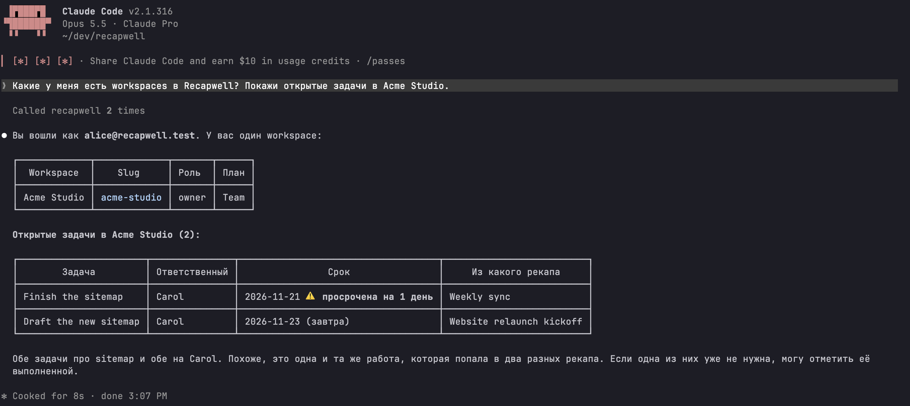

# Recapwell

> Meeting notes in. Clear recap out.

**Recapwell** is a portfolio demo of a multi-tenant B2B SaaS. A team member pastes meeting notes and gets a summary, action items with owners and a ready-to-send follow-up email. Everything belongs to a **workspace (organization)** with members, roles, a Stripe subscription and feature modules that can be switched on or off per workspace.

Recapwell is a fictional product. Stripe runs in **test mode** only.

## Stack

- **Next.js 16** (App Router, Cache Components / Partial Prerendering, `proxy.ts`) + TypeScript
- **Tailwind CSS v4**
- **Supabase**: Auth (email + password, Google OAuth), Postgres, Row Level Security, SQL migrations, pgTAP tests
- **Stripe** (sandbox): subscription per workspace, Checkout, signed + idempotent webhooks, Customer Portal
- **Claude API**: recap generation with validated JSON output *(step 6)*
- **MCP server** (`mcp/`): use Recapwell from Claude Desktop / Claude Code — TypeScript, `@modelcontextprotocol/sdk`, stdio
- **Vitest** + **GitHub Actions** *(step 9)*, **Vercel** deploy

## Roadmap

- [x] 1. Next.js scaffold + Supabase Auth (email/password, Google, protected `/app`)
- [x] 2. Database schema, Row Level Security, seed data, pgTAP tests
- [x] 3. Organizations UI: onboarding, workspace switcher, members, invites, roles
- [x] 4. Stripe: Checkout per workspace, webhooks → `subscriptions`
- [x] 5. Billing page + Customer Portal
- [x] 6. AI recaps (Claude API) + plan and usage gating
- [x] 6a. MCP server: use Recapwell from Claude (local, stdio)
- [ ] 7. Modules: follow-up email, action tracker, export
- [ ] 8. Workspace dashboard + super-admin dashboard
- [ ] 9. Vitest, GitHub Actions CI, audit log in the UI
- [ ] 10. Deploy, demo accounts, landing + pricing

## Multi-tenancy model

```
auth.users ─┬─ profiles
            └─ memberships (role: owner | admin | member) ─── organizations
                                                               ├─ subscriptions (plan: free | team)
                                                               ├─ org_modules (module on/off)
                                                               ├─ invitations
                                                               ├─ recaps ── action_items
                                                               ├─ usage_counters
                                                               └─ audit_log
```

| Plan | Members | Recaps / month | Modules |
|---|---|---|---|
| Free | 3 | 10 | Summary |
| Team ($29/mo) | 15 | 300 | Summary, Follow-up email, Action tracker, Export |

**Tenant isolation is enforced in Postgres, not only in the UI.**

- Every org-scoped table has RLS policies based on `private.is_member(org_id)` and `private.has_role(org_id, roles)`. These helpers are `security definer`, which avoids the classic recursive-policy trap on `memberships`.
- Column-level grants limit what a signed-in user can change at all (e.g. `profiles.is_super_admin`, `subscriptions` and `usage_counters` are never writable from the client).
- Billing, usage and recap creation are written only by the server with the Supabase secret key (Stripe webhooks, the Claude route).
- Multi-row operations with business rules are Postgres functions (RPCs): `create_organization`, `accept_invitation`, `set_member_role`, `remove_member`, `get_invitation`, `org_enabled_modules`. Rules include "a workspace always keeps an owner", "admins can't touch owners", "an invite only works for its email" and plan member limits.
- Key actions are written to `audit_log`.

The isolation is covered by **pgTAP tests** in `supabase/tests/database/`: another tenant's data, plan upgrades, self-promotion to owner or super admin, and guest access all fail.

## How auth works

| File | What it does |
|---|---|
| `src/proxy.ts` | Runs before every request (Next 16's replacement for `middleware.ts`). Refreshes the Supabase session cookie and redirects guests away from `/app/*`. |
| `src/lib/supabase/server.ts` | Server client + `getCurrentUser()` using `getClaims()` (verified JWT). |
| `src/lib/supabase/client.ts` | Browser client for Client Components. |
| `src/app/auth/actions.ts` | Server Actions: sign in, sign up, Google OAuth, sign out. |
| `src/app/auth/callback/route.ts` | Exchanges the PKCE code from Google / email-confirmation links for a session. |
| `src/lib/safe-redirect.ts` | Validates `?next=` so it can't be used as an open redirect. |

## Local setup

Requires Node 20+ and Docker Desktop.

```bash
npm install
npm run db:start             # local Supabase in Docker (first run downloads images)
cp .env.example .env.local   # paste the Project URL and Publishable key printed by db:start
npm run db:reset             # apply migrations + seed demo data
npm run dev                  # http://localhost:3000
```

Local URLs: Studio http://127.0.0.1:54323 · Mailpit (test emails) http://127.0.0.1:54324

### Stripe (sandbox)

1. Create a Stripe account and open its **sandbox** (no business verification needed).
2. Put the sandbox secret key (`sk_test_…`) into `.env.local` as `STRIPE_SECRET_KEY`, and the local Supabase "Secret" key as `SUPABASE_SECRET_KEY`.
3. `npm run stripe:setup` creates the **Recapwell Team** product with `recapwell_team_monthly` ($29) and `recapwell_team_yearly` ($290) prices. Prices are found by lookup key, so no price IDs in env vars.
4. Install the Stripe CLI (`brew install stripe/stripe-cli/stripe`), run `stripe login`, then keep `npm run stripe:listen` running next to `npm run dev`. Copy the `whsec_…` it prints into `.env.local` as `STRIPE_WEBHOOK_SECRET` and restart the dev server.
5. Billing → Upgrade, pay with `4242 4242 4242 4242`, any future date, any CVC.

How billing works:

- One Stripe customer per **workspace** (`metadata.org_id`), created on first checkout.
- The Checkout redirect does not change the plan. Only the webhook does: `POST /api/stripe/webhook` verifies the signature on the raw body, records the event id in `stripe_events` (duplicates are acknowledged and skipped), then re-reads the subscription from Stripe and writes plan, status and period end to `subscriptions` with the server-only admin client.
- Handled events: `checkout.session.completed`, `customer.subscription.created|updated|deleted`, `invoice.paid`, `invoice.payment_failed`. `past_due` keeps Team features while Stripe retries; anything else falls back to Free.
- Plan changes are written to `audit_log`.
- **Billing page** (`/app/<slug>/billing`): plan, status and renewal/end date, usage bars (recaps this month, members) against the plan limits, Upgrade (Free), **Manage billing** → Stripe Customer Portal (card, invoices, monthly ↔ yearly), **Cancel** at the end of the period and **Keep my Team plan** to undo it. Only owners/admins see billing actions; every action re-checks the role on the server (`src/lib/billing/guard.ts`).
- Cancel/resume call Stripe and then sync right away, so the page updates without waiting for the webhook. A cancellation scheduled in the portal (`cancel_at`) is recognised the same way as `cancel_at_period_end`.
- **Failed payments**: while Stripe retries (`past_due`) the workspace keeps Team features and every page shows a red banner; owners/admins get a direct link to update the card. If Stripe gives up, the plan falls back to Free.

Customer Portal setup (once, in the sandbox): Settings → Billing → Customer portal → enable payment methods, invoices, cancellations at the end of the period and *switch plans* with both Recapwell Team prices → Save.

**Testing a failed payment.** The webhook path is the same for every event, so the UI can be checked locally by flipping the status:

```bash
docker exec supabase_db_recapwell psql -U postgres \
  -c "update subscriptions set status = 'past_due' where org_id = '<org id>'"
```

Every page of that workspace then shows the past-due banner. Any Stripe event, or Cancel → Keep on the Billing page, re-syncs the real status. An end-to-end check of a failed renewal uses Stripe test clocks (a subscription on a clock, card `4000 0000 0000 0341`, advance the clock past the renewal) — planned with the test suite. Note: these subscriptions use Stripe's flexible billing mode, where resetting the billing cycle with `proration_behavior=none` doesn't create an invoice, so it can't be used to force a charge.

### Claude API (recaps)

Create a key in the Claude Console (platform.claude.com → API keys) and put it into `.env.local` as `ANTHROPIC_API_KEY`. The default model is `claude-haiku-5-5` (about $0.001 per recap); set `ANTHROPIC_MODEL=claude-sonnet-5-5` for harder notes.

How a recap is made (`src/app/app/[orgSlug]/recaps/actions.ts`):

1. **Who and what.** The user must be a member of the workspace (RLS); title and notes are validated with zod.
2. **Plan and modules.** `org_enabled_modules()` in Postgres decides what the workspace may use. The `summary` module is required; the follow-up email is generated only when `followup_email` is on (Team).
3. **Monthly limit.** `reserve_recap(org)` counts the recap in `usage_counters` and checks the plan limit in one statement, so two parallel requests can't both take the last recap. It's callable only with the secret key. If anything below fails, `release_recap()` gives the recap back.
4. **Claude call** on the server with **structured outputs**: the zod schema in `src/lib/ai/recap-schema.ts` is sent as a JSON schema, so the answer is shaped by the API.
5. **Validation + repair** (`src/lib/ai/repair.ts`): the answer is checked again against the full zod schema, including the limits the API can't enforce (lengths, list sizes, real dates). Code fences or text around the JSON are stripped locally. If it's still invalid, or was cut off (`max_tokens`), Claude gets one repair turn with the exact validation errors. A refusal is not retried.
6. **Save** with the secret key: the recap (with model and token counts), its action items and an `audit_log` entry (`recap.created`, incl. the number of attempts). Users have no insert rights on `recaps`/`action_items`, so the limit can't be skipped through the API.

The meeting notes are passed as data inside `<notes>` tags, and the system prompt tells Claude to ignore instructions inside them.

### Demo accounts (password `password123`)

| Email | Role |
|---|---|
| alice@recapwell.test | Owner of **Acme Studio** (Team) |
| carol@recapwell.test | Member of Acme Studio; has a pending invite to Bluebird |
| bob@recapwell.test | Owner of **Bluebird Labs** (Free) |
| admin@recapwell.test | Super admin, no workspace |

### Database scripts

```bash
npm run db:start   # start local Supabase
npm run db:stop    # stop it
npm run db:reset   # re-create the DB from migrations + seed
npm run db:test    # run the pgTAP tests (after db:reset)
npm run db:types   # regenerate src/lib/database.types.ts from the local schema
```

New schema change: `npx supabase migration new <name>`, write SQL, then `npm run db:reset && npm run db:test`.

### Google sign-in (optional)

1. Google Cloud Console → APIs & Services → Credentials → **OAuth client ID** (Web application).
2. Authorized redirect URI: `https://<project-ref>.supabase.co/auth/v1/callback` (for local Supabase: `http://127.0.0.1:54321/auth/v1/callback`).
3. Supabase → Authentication → Providers → **Google** (or `[auth.external.google]` in `supabase/config.toml` locally).

## Use Recapwell from Claude (MCP server)

`mcp/` is a small [Model Context Protocol](https://modelcontextprotocol.io) server. Connect it to Claude Desktop or Claude Code and ask things like *"What's still open in Acme Studio?"* — Claude reads your workspaces, recaps and action items, and can tick an item off.



**Tools**

| Tool | What it does | Writes? |
|---|---|---|
| `list_workspaces` | Your workspaces with slug, role and plan | — |
| `list_recaps(org_slug, limit)` | Latest recaps with ids and short summaries | — |
| `get_recap(recap_id)` | Summary, decisions, open questions, action items, follow-up email | — |
| `list_open_action_items(org_slug, owner?)` | Open items, soonest due first, optional owner filter | — |
| `mark_action_item_done(action_item_id, done?)` | Marks an item done (or re-opens it) | ✓ |

**Security model.** The server signs in to Supabase **as a normal Recapwell user** (publishable key + email/password) — no secret key. Every query goes through the same Row Level Security as the web app, so Claude only sees that user's workspaces, and the single write uses the existing column grant on `action_items.done`. Inputs are validated with zod; database and auth errors come back as short, readable tool errors.

**Design.** Tools depend on a `RecapwellData` interface (`mcp/src/data.ts`), implemented with supabase-js in `supabase-data.ts`. Tests in `mcp/src/server.test.ts` run a real MCP client against the server over an in-memory transport with a fake data layer (validation, results, error texts).

### Set up

```bash
npm install            # installs the mcp/ workspace too
npm run db:start       # local Supabase must be running
cp mcp/.env.example mcp/.env   # publishable key from db:start + a demo user
npm run mcp:build      # → mcp/dist/index.js
npm run mcp:test       # Vitest
npm run mcp:inspect    # optional: try the tools in MCP Inspector
```

### Claude Code

```bash
claude mcp add recapwell -- node /absolute/path/to/recapwell/mcp/dist/index.js
```

Credentials come from `mcp/.env`. Check with `/mcp` inside Claude Code (`✔ recapwell · 5 tools`).

### Claude Desktop

Add to `~/Library/Application Support/Claude/claude_desktop_config.json` and restart Claude Desktop. Use the absolute path to `node` (`which node`) — Desktop doesn't load your shell's PATH (nvm etc.).

```json
{
  "mcpServers": {
    "recapwell": {
      "command": "/absolute/path/to/node",
      "args": ["/absolute/path/to/recapwell/mcp/dist/index.js"],
      "env": {
        "RECAPWELL_SUPABASE_URL": "http://127.0.0.1:54321",
        "RECAPWELL_SUPABASE_KEY": "sb_publishable_...",
        "RECAPWELL_EMAIL": "alice@recapwell.test",
        "RECAPWELL_PASSWORD": "password123"
      }
    }
  }
}
```

### Example conversation

> **You:** What's still open in Acme Studio, and who owns it?
>
> **Claude:** *(calls `list_workspaces`, then `list_open_action_items` with `org_slug: "acme-studio"`)* Two items are open, both owned by Carol: "Finish the sitemap" (due Nov 25, from *Weekly sync*) and "Draft the new sitemap" (due Nov 27, from *Website relaunch kickoff*).
>
> **You:** Mark "Finish the sitemap" as done.
>
> **Claude:** *(calls `mark_action_item_done`)* Done — "Finish the sitemap" is checked off. One open item left in Acme Studio.

Signed in as `bob@recapwell.test`, the same questions about Acme Studio return *"No workspace "acme-studio" — it doesn't exist or you're not a member"*: RLS at work.

A remote version (Streamable HTTP at `/api/mcp` on Vercel, with per-user auth) is planned for the deploy step.

## Scripts

```bash
npm run dev     # dev server
npm run build   # production build
npm run lint    # ESLint
```
